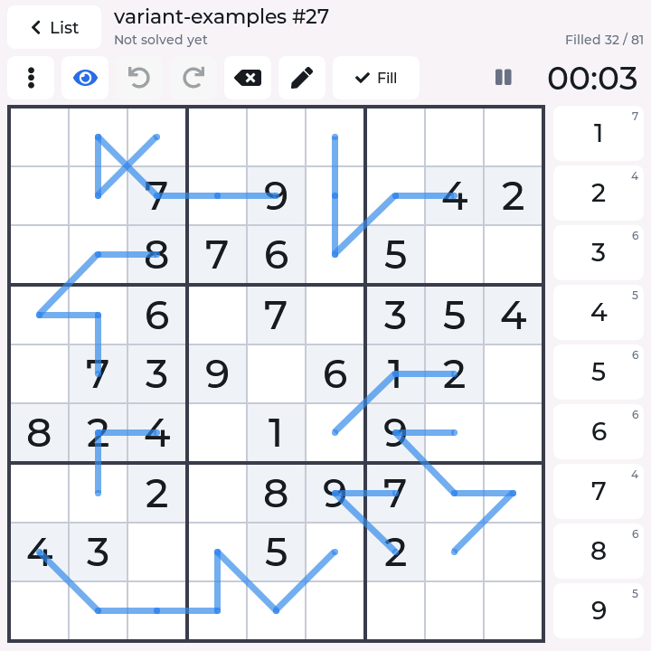

# Region Sum Lines

[← All variants](README.md) · [Puzzles](../features-puzzles.md) · [How to play](../how-to-play.md)

## The rules

[Classic](classic.md) rules, plus **blue lines** through cells side by side or diagonal, each passing through two boxes or more. Where a line passes through a box, the digits on it there make a **part**, and **every part of a line adds up to the same total**. On a line through two boxes holding 2, 6 in one and 5, 3 in the other, both parts are 8. A box the line enters twice counts both of its stretches together as one part.

The digits in one part are in one box, so they never repeat; digits in different parts may.

## On the board

- Each line is a narrow blue line under the digits; the box borders show where its parts begin and end.
- When two of a line's parts are full and add up to different totals, or a part not yet full is already at or past a full one's total, the line's digits turn red.
- The grader and hints compare each part's smallest and biggest possible total with the others': "In each box this line passes through, its digits add up to the same, so row 6, column 6 can only be 3".
- **Puzzles → ⋮ → New puzzle → Region Sum**: 8 lines (Hard and Expert 10) of 3 to 8 cells.

## How to solve it

- **A one-cell part is the line's total:** if a line has a single cell in one box, that cell is the sum of every other part.
- **A full part gives the total:** fill one part and every other part must match it.
- **Count the cells:** a part's digits are in one box, so they never repeat: a part of two cells is at least 1 + 2 = 3, of three at least 6, of four at least 10. A one-cell part on the same line is at most 9, so a three-cell part beside it is 6 to 9 (1 2 3, 1 2 4, 1 2 5 or 1 3 4, ...).
- **Long parts make big totals:** a part of four cells is at least 10, so a one-cell part on the same line is impossible; the generator never makes one.

## Worked example

**variant-examples #27**, Region Sum Lines Easy (see [Classic](classic.md#worked-example-the-whole-puzzle) for how to import the examples; cells are written r*row*c*column*). The lines are in the picture; three matter here:

- a line of **three**: r5c8 (a 2) and r5c7 (a 1) in box 6, then r6c6 in box 5;
- another line of **three**: r6c3 (a 4) and r6c2 (a 2) in box 4, then r7c2 in box 7;
- a line of **six**: r2c5 (a 9) and r2c4 in box 2, then r2c3 (a 7), r1c2, r2c2 and r1c3 in box 1.

**Step 1: r6c6, on the first line.** Row 6 has 1, 2, 4, 8 and 9; column 6 has a 6; box 5 has a 7. By the Classic rules r6c6 could be 3 or 5. Its part in box 5 is just r6c6, and the part in box 6 is already full: 2 + 1 = 3. **r6c6 = 3**.

**Step 2: r7c2, on the second line.** Row 7 has 2, 7, 8 and 9; column 2 has a 3; box 7 has a 4; that leaves 1, 5 and 6. The part in box 4 is full: 4 + 2 = 6, and r7c2 is the whole part in box 7. **r7c2 = 6**.

**Step 3: the 3 in row 2.** Row 2 has 2, 4, 7 and 9. The 3s in r8c2, r6c6 (step 1) and r4c7 rule it out of r2c2, r2c6 and r2c7. That leaves r2c1 and r2c4. r2c4 is on the line of six: the line's part in box 1 has the 7 and three more cells of that box, different digits, so it is at least 7 + 1 + 2 + 3 = 13. The part in box 2 is 9 + r2c4, so r2c4 is at least 4: not a 3. **r2c1 = 3**.

## The whole puzzle, step by step

<!-- walkthrough -->
<!-- Written by tools/walkthrough.py region-sum-lines: edit the script, not this part. -->

The whole puzzle, from the start to the last cell: 49 steps, each one a single (one place left for a digit, or one digit left for a cell), taken in the order a box's single comes first, so not quite the order of the worked example above. Each step has a page of its own, with **Previous** and **Next**: pick its number below. In each picture, the unit the step looks at is tinted yellow (for a cell with one digit left: its row, column and box), the new digit is on green, the digits that rule cells out have an **orange ring**, and the empty cells they rule out a **red cross**. Givens are on grey, digits from earlier steps in blue.

| [1](region-sum-lines/step-01.md) | [2](region-sum-lines/step-02.md) | [3](region-sum-lines/step-03.md) | [4](region-sum-lines/step-04.md) | [5](region-sum-lines/step-05.md) | [6](region-sum-lines/step-06.md) | [7](region-sum-lines/step-07.md) | [8](region-sum-lines/step-08.md) | [9](region-sum-lines/step-09.md) | [10](region-sum-lines/step-10.md) |
|:-:|:-:|:-:|:-:|:-:|:-:|:-:|:-:|:-:|:-:|
| [11](region-sum-lines/step-11.md) | [12](region-sum-lines/step-12.md) | [13](region-sum-lines/step-13.md) | [14](region-sum-lines/step-14.md) | [15](region-sum-lines/step-15.md) | [16](region-sum-lines/step-16.md) | [17](region-sum-lines/step-17.md) | [18](region-sum-lines/step-18.md) | [19](region-sum-lines/step-19.md) | [20](region-sum-lines/step-20.md) |
| [21](region-sum-lines/step-21.md) | [22](region-sum-lines/step-22.md) | [23](region-sum-lines/step-23.md) | [24](region-sum-lines/step-24.md) | [25](region-sum-lines/step-25.md) | [26](region-sum-lines/step-26.md) | [27](region-sum-lines/step-27.md) | [28](region-sum-lines/step-28.md) | [29](region-sum-lines/step-29.md) | [30](region-sum-lines/step-30.md) |
| [31](region-sum-lines/step-31.md) | [32](region-sum-lines/step-32.md) | [33](region-sum-lines/step-33.md) | [34](region-sum-lines/step-34.md) | [35](region-sum-lines/step-35.md) | [36](region-sum-lines/step-36.md) | [37](region-sum-lines/step-37.md) | [38](region-sum-lines/step-38.md) | [39](region-sum-lines/step-39.md) | [40](region-sum-lines/step-40.md) |
| [41](region-sum-lines/step-41.md) | [42](region-sum-lines/step-42.md) | [43](region-sum-lines/step-43.md) | [44](region-sum-lines/step-44.md) | [45](region-sum-lines/step-45.md) | [46](region-sum-lines/step-46.md) | [47](region-sum-lines/step-47.md) | [48](region-sum-lines/step-48.md) | [49](region-sum-lines/step-49.md) |  |

Solved.

<!-- /walkthrough -->
