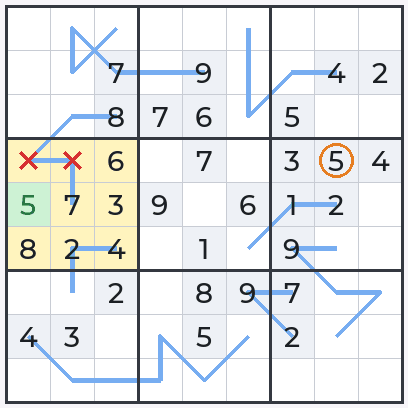

<!-- Written by tools/walkthrough.py region-sum-lines: edit the script, not this page. -->
# Region Sum Lines, step 1: the 5 in box 4

**Step 1 of 49** · [← The start](../region-sum-lines.md#the-whole-puzzle-step-by-step) · [All steps](../region-sum-lines.md#the-whole-puzzle-step-by-step) · [Step 2 →](step-02.md)

Box 4 needs a 5. r4c1 and r4c2: row 4 has one (r4c8). Only **r5c1** is left: **r5c1 = 5**.

**Step 1 of 49** · [← The start](../region-sum-lines.md#the-whole-puzzle-step-by-step) · [All steps](../region-sum-lines.md#the-whole-puzzle-step-by-step) · [Step 2 →](step-02.md)
