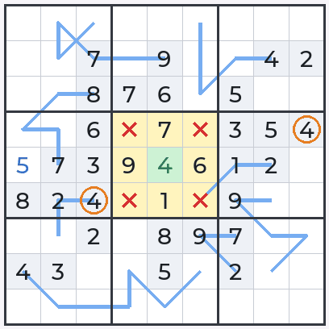

<!-- Written by tools/walkthrough.py region-sum-lines: edit the script, not this page. -->
# Region Sum Lines, step 2: the 4 in box 5

**Step 2 of 49** · [← Step 1](step-01.md) · [All steps](../region-sum-lines.md#the-whole-puzzle-step-by-step) · [Step 3 →](step-03.md)

Box 5 needs a 4. r4c4 and r4c6: row 4 has one (r4c9). r6c4 and r6c6: row 6 has one (r6c3). Only **r5c5** is left: **r5c5 = 4**.

**Step 2 of 49** · [← Step 1](step-01.md) · [All steps](../region-sum-lines.md#the-whole-puzzle-step-by-step) · [Step 3 →](step-03.md)
