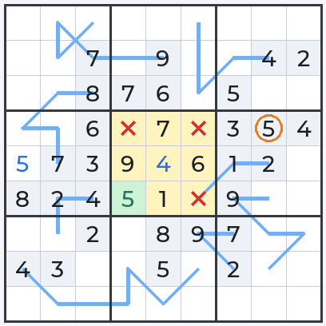

<!-- Written by tools/walkthrough.py region-sum-lines: edit the script, not this page. -->
# Region Sum Lines, step 3: the 5 in box 5

**Step 3 of 49** · [← Step 2](step-02.md) · [All steps](../region-sum-lines.md#the-whole-puzzle-step-by-step) · [Step 4 →](step-04.md)

Box 5 needs a 5. r4c4 and r4c6: row 4 has one (r4c8). r6c6: its blue line adds up to 3 in another box, and a 5 would make its part in this box 5. Only **r6c4** is left: **r6c4 = 5**.

**Step 3 of 49** · [← Step 2](step-02.md) · [All steps](../region-sum-lines.md#the-whole-puzzle-step-by-step) · [Step 4 →](step-04.md)
