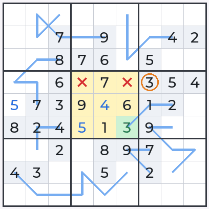

<!-- Written by tools/walkthrough.py region-sum-lines: edit the script, not this page. -->
# Region Sum Lines, step 4: the 3 in box 5

**Step 4 of 49** · [← Step 3](step-03.md) · [All steps](../region-sum-lines.md#the-whole-puzzle-step-by-step) · [Step 5 →](step-05.md)

Box 5 needs a 3. r4c4 and r4c6: row 4 has one (r4c7). Only **r6c6** is left: **r6c6 = 3**.

**Step 4 of 49** · [← Step 3](step-03.md) · [All steps](../region-sum-lines.md#the-whole-puzzle-step-by-step) · [Step 5 →](step-05.md)
