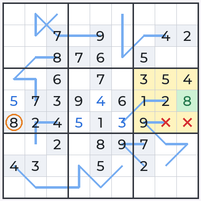

<!-- Written by tools/walkthrough.py region-sum-lines: edit the script, not this page. -->
# Region Sum Lines, step 5: the 8 in box 6

**Step 5 of 49** · [← Step 4](step-04.md) · [All steps](../region-sum-lines.md#the-whole-puzzle-step-by-step) · [Step 6 →](step-06.md)

Box 6 needs an 8. r6c8 and r6c9: row 6 has one (r6c1). Only **r5c9** is left: **r5c9 = 8**.

**Step 5 of 49** · [← Step 4](step-04.md) · [All steps](../region-sum-lines.md#the-whole-puzzle-step-by-step) · [Step 6 →](step-06.md)
