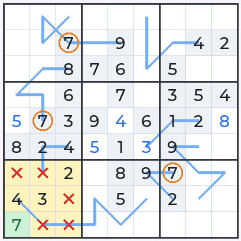

<!-- Written by tools/walkthrough.py region-sum-lines: edit the script, not this page. -->
# Region Sum Lines, step 6: the 7 in box 7

**Step 6 of 49** · [← Step 5](step-05.md) · [All steps](../region-sum-lines.md#the-whole-puzzle-step-by-step) · [Step 7 →](step-07.md)

Box 7 needs a 7. r7c1 and r7c2: row 7 has one (r7c7). r8c3 and r9c3: column 3 has one (r2c3). r9c2: column 2 has one (r5c2). Only **r9c1** is left: **r9c1 = 7**.

**Step 6 of 49** · [← Step 5](step-05.md) · [All steps](../region-sum-lines.md#the-whole-puzzle-step-by-step) · [Step 7 →](step-07.md)
