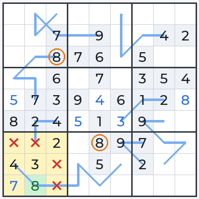

<!-- Written by tools/walkthrough.py region-sum-lines: edit the script, not this page. -->
# Region Sum Lines, step 7: the 8 in box 7

**Step 7 of 49** · [← Step 6](step-06.md) · [All steps](../region-sum-lines.md#the-whole-puzzle-step-by-step) · [Step 8 →](step-08.md)

Box 7 needs an 8. r7c1 and r7c2: row 7 has one (r7c5). r8c3 and r9c3: column 3 has one (r3c3). Only **r9c2** is left: **r9c2 = 8**.

**Step 7 of 49** · [← Step 6](step-06.md) · [All steps](../region-sum-lines.md#the-whole-puzzle-step-by-step) · [Step 8 →](step-08.md)
