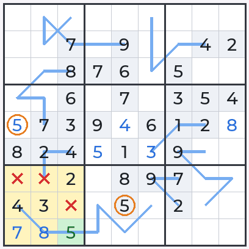

<!-- Written by tools/walkthrough.py region-sum-lines: edit the script, not this page. -->
# Region Sum Lines, step 8: the 5 in box 7

**Step 8 of 49** · [← Step 7](step-07.md) · [All steps](../region-sum-lines.md#the-whole-puzzle-step-by-step) · [Step 9 →](step-09.md)

Box 7 needs a 5. r7c1: column 1 has one (r5c1). r8c3: row 8 has one (r8c5). r7c2: its blue line adds up to 6 in another box, and a 5 would make its part in this box 5. Only **r9c3** is left: **r9c3 = 5**.

**Step 8 of 49** · [← Step 7](step-07.md) · [All steps](../region-sum-lines.md#the-whole-puzzle-step-by-step) · [Step 9 →](step-09.md)
