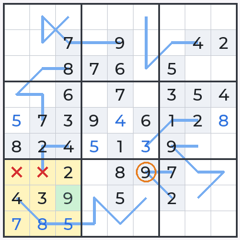

<!-- Written by tools/walkthrough.py region-sum-lines: edit the script, not this page. -->
# Region Sum Lines, step 9: the 9 in box 7

**Step 9 of 49** · [← Step 8](step-08.md) · [All steps](../region-sum-lines.md#the-whole-puzzle-step-by-step) · [Step 10 →](step-10.md)

Box 7 needs a 9. r7c1 and r7c2: row 7 has one (r7c6). Only **r8c3** is left: **r8c3 = 9**.

**Step 9 of 49** · [← Step 8](step-08.md) · [All steps](../region-sum-lines.md#the-whole-puzzle-step-by-step) · [Step 10 →](step-10.md)
