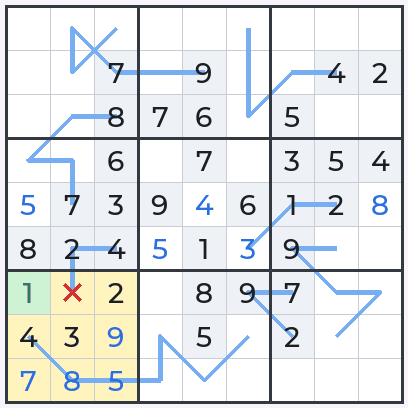

<!-- Written by tools/walkthrough.py region-sum-lines: edit the script, not this page. -->
# Region Sum Lines, step 10: the 1 in box 7

**Step 10 of 49** · [← Step 9](step-09.md) · [All steps](../region-sum-lines.md#the-whole-puzzle-step-by-step) · [Step 11 →](step-11.md)

Box 7 needs a 1. r7c2: its blue line adds up to 6 in another box, and a 1 would make its part in this box 1. Only **r7c1** is left: **r7c1 = 1**.

**Step 10 of 49** · [← Step 9](step-09.md) · [All steps](../region-sum-lines.md#the-whole-puzzle-step-by-step) · [Step 11 →](step-11.md)
