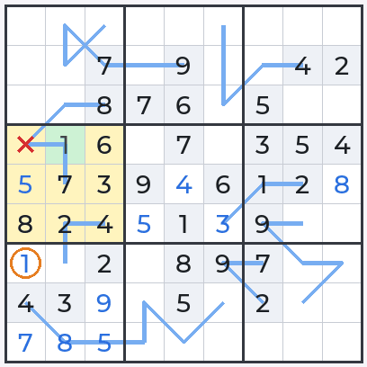

<!-- Written by tools/walkthrough.py region-sum-lines: edit the script, not this page. -->
# Region Sum Lines, step 11: the 1 in box 4

**Step 11 of 49** · [← Step 10](step-10.md) · [All steps](../region-sum-lines.md#the-whole-puzzle-step-by-step) · [Step 12 →](step-12.md)

Box 4 needs a 1. r4c1: column 1 has one (r7c1). Only **r4c2** is left: **r4c2 = 1**.

**Step 11 of 49** · [← Step 10](step-10.md) · [All steps](../region-sum-lines.md#the-whole-puzzle-step-by-step) · [Step 12 →](step-12.md)
