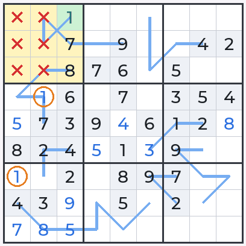

<!-- Written by tools/walkthrough.py region-sum-lines: edit the script, not this page. -->
# Region Sum Lines, step 12: the 1 in box 1

**Step 12 of 49** · [← Step 11](step-11.md) · [All steps](../region-sum-lines.md#the-whole-puzzle-step-by-step) · [Step 13 →](step-13.md)

Box 1 needs a 1. r1c1, r2c1 and r3c1: column 1 has one (r7c1). r1c2, r2c2 and r3c2: column 2 has one (r4c2). Only **r1c3** is left: **r1c3 = 1**.

**Step 12 of 49** · [← Step 11](step-11.md) · [All steps](../region-sum-lines.md#the-whole-puzzle-step-by-step) · [Step 13 →](step-13.md)
