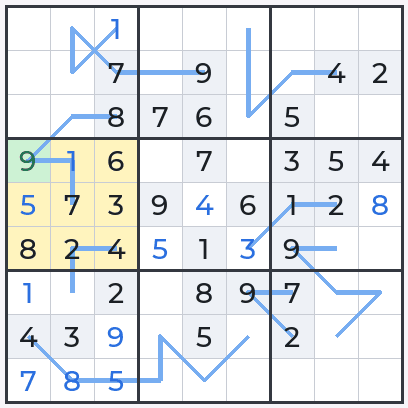

<!-- Written by tools/walkthrough.py region-sum-lines: edit the script, not this page. -->
# Region Sum Lines, step 13: the 9 in box 4

**Step 13 of 49** · [← Step 12](step-12.md) · [All steps](../region-sum-lines.md#the-whole-puzzle-step-by-step) · [Step 14 →](step-14.md)

Box 4 needs a 9, and r4c1 is its last empty cell: **r4c1 = 9**.

**Step 13 of 49** · [← Step 12](step-12.md) · [All steps](../region-sum-lines.md#the-whole-puzzle-step-by-step) · [Step 14 →](step-14.md)
