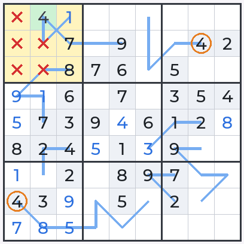

<!-- Written by tools/walkthrough.py region-sum-lines: edit the script, not this page. -->
# Region Sum Lines, step 14: the 4 in box 1

**Step 14 of 49** · [← Step 13](step-13.md) · [All steps](../region-sum-lines.md#the-whole-puzzle-step-by-step) · [Step 15 →](step-15.md)

Box 1 needs a 4. r1c1 and r3c1: column 1 has one (r8c1). r2c1 and r2c2: row 2 has one (r2c8). r3c2: its blue line adds up to 17 in another box, and a 4 would make its part in this box 12. Only **r1c2** is left: **r1c2 = 4**.

**Step 14 of 49** · [← Step 13](step-13.md) · [All steps](../region-sum-lines.md#the-whole-puzzle-step-by-step) · [Step 15 →](step-15.md)
