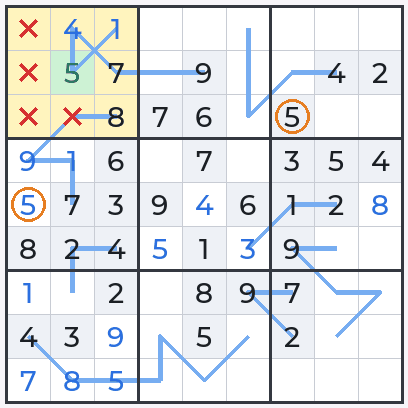

<!-- Written by tools/walkthrough.py region-sum-lines: edit the script, not this page. -->
# Region Sum Lines, step 15: the 5 in box 1

**Step 15 of 49** · [← Step 14](step-14.md) · [All steps](../region-sum-lines.md#the-whole-puzzle-step-by-step) · [Step 16 →](step-16.md)

Box 1 needs a 5. r1c1 and r2c1: column 1 has one (r5c1). r3c1 and r3c2: row 3 has one (r3c7). Only **r2c2** is left: **r2c2 = 5**.

**Step 15 of 49** · [← Step 14](step-14.md) · [All steps](../region-sum-lines.md#the-whole-puzzle-step-by-step) · [Step 16 →](step-16.md)
