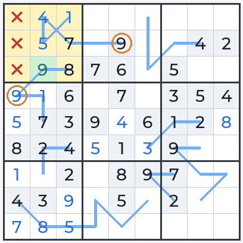

<!-- Written by tools/walkthrough.py region-sum-lines: edit the script, not this page. -->
# Region Sum Lines, step 16: the 9 in box 1

**Step 16 of 49** · [← Step 15](step-15.md) · [All steps](../region-sum-lines.md#the-whole-puzzle-step-by-step) · [Step 17 →](step-17.md)

Box 1 needs a 9. r1c1 and r3c1: column 1 has one (r4c1). r2c1: row 2 has one (r2c5). Only **r3c2** is left: **r3c2 = 9**.

**Step 16 of 49** · [← Step 15](step-15.md) · [All steps](../region-sum-lines.md#the-whole-puzzle-step-by-step) · [Step 17 →](step-17.md)
