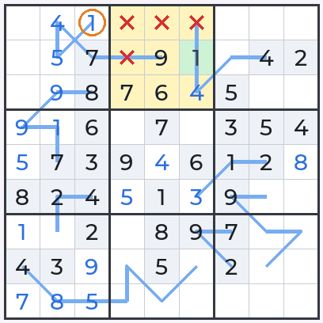

<!-- Written by tools/walkthrough.py region-sum-lines: edit the script, not this page. -->
# Region Sum Lines, step 18: the 1 in box 2

**Step 18 of 49** · [← Step 17](step-17.md) · [All steps](../region-sum-lines.md#the-whole-puzzle-step-by-step) · [Step 19 →](step-19.md)

Box 2 needs a 1. r1c4, r1c5 and r1c6: row 1 has one (r1c3). r2c4: its blue line adds up to 17 in another box, and a 1 would make its part in this box 10. Only **r2c6** is left: **r2c6 = 1**.

**Step 18 of 49** · [← Step 17](step-17.md) · [All steps](../region-sum-lines.md#the-whole-puzzle-step-by-step) · [Step 19 →](step-19.md)
