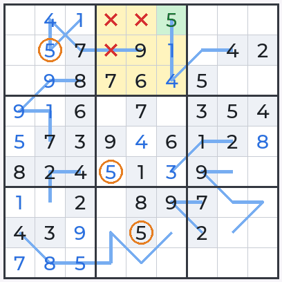

<!-- Written by tools/walkthrough.py region-sum-lines: edit the script, not this page. -->
# Region Sum Lines, step 19: the 5 in box 2

**Step 19 of 49** · [← Step 18](step-18.md) · [All steps](../region-sum-lines.md#the-whole-puzzle-step-by-step) · [Step 20 →](step-20.md)

Box 2 needs a 5. r1c4: column 4 has one (r6c4). r1c5: column 5 has one (r8c5). r2c4: row 2 has one (r2c2). Only **r1c6** is left: **r1c6 = 5**.

**Step 19 of 49** · [← Step 18](step-18.md) · [All steps](../region-sum-lines.md#the-whole-puzzle-step-by-step) · [Step 20 →](step-20.md)
