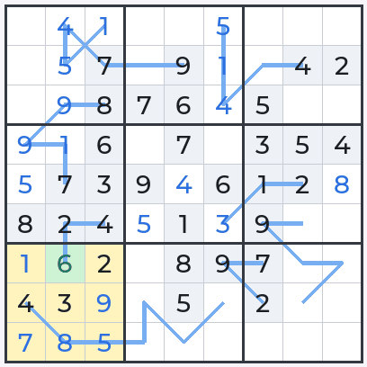

<!-- Written by tools/walkthrough.py region-sum-lines: edit the script, not this page. -->
# Region Sum Lines, step 20: the 6 in box 7

**Step 20 of 49** · [← Step 19](step-19.md) · [All steps](../region-sum-lines.md#the-whole-puzzle-step-by-step) · [Step 21 →](step-21.md)

Box 7 needs a 6, and r7c2 is its last empty cell: **r7c2 = 6**.

**Step 20 of 49** · [← Step 19](step-19.md) · [All steps](../region-sum-lines.md#the-whole-puzzle-step-by-step) · [Step 21 →](step-21.md)
