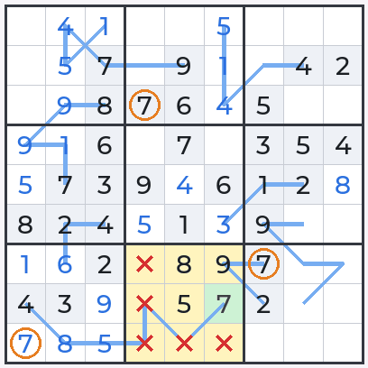

<!-- Written by tools/walkthrough.py region-sum-lines: edit the script, not this page. -->
# Region Sum Lines, step 21: the 7 in box 8

**Step 21 of 49** · [← Step 20](step-20.md) · [All steps](../region-sum-lines.md#the-whole-puzzle-step-by-step) · [Step 22 →](step-22.md)

Box 8 needs a 7. r7c4: row 7 has one (r7c7). r8c4: column 4 has one (r3c4). r9c4, r9c5 and r9c6: row 9 has one (r9c1). Only **r8c6** is left: **r8c6 = 7**.

**Step 21 of 49** · [← Step 20](step-20.md) · [All steps](../region-sum-lines.md#the-whole-puzzle-step-by-step) · [Step 22 →](step-22.md)
