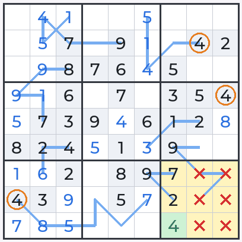

<!-- Written by tools/walkthrough.py region-sum-lines: edit the script, not this page. -->
# Region Sum Lines, step 22: the 4 in box 9

**Step 22 of 49** · [← Step 21](step-21.md) · [All steps](../region-sum-lines.md#the-whole-puzzle-step-by-step) · [Step 23 →](step-23.md)

Box 9 needs a 4. r7c8 and r9c8: column 8 has one (r2c8). r7c9 and r9c9: column 9 has one (r4c9). r8c8 and r8c9: row 8 has one (r8c1). Only **r9c7** is left: **r9c7 = 4**.

**Step 22 of 49** · [← Step 21](step-21.md) · [All steps](../region-sum-lines.md#the-whole-puzzle-step-by-step) · [Step 23 →](step-23.md)
