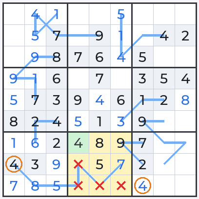

<!-- Written by tools/walkthrough.py region-sum-lines: edit the script, not this page. -->
# Region Sum Lines, step 23: the 4 in box 8

**Step 23 of 49** · [← Step 22](step-22.md) · [All steps](../region-sum-lines.md#the-whole-puzzle-step-by-step) · [Step 24 →](step-24.md)

Box 8 needs a 4. r8c4: row 8 has one (r8c1). r9c4, r9c5 and r9c6: row 9 has one (r9c7). Only **r7c4** is left: **r7c4 = 4**.

**Step 23 of 49** · [← Step 22](step-22.md) · [All steps](../region-sum-lines.md#the-whole-puzzle-step-by-step) · [Step 24 →](step-24.md)
