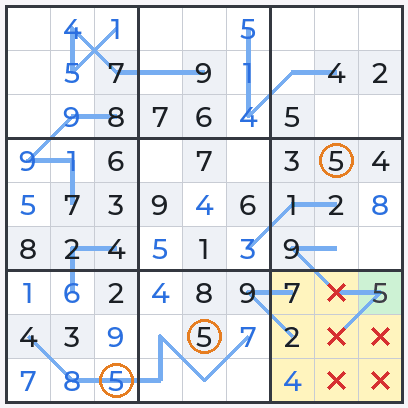

<!-- Written by tools/walkthrough.py region-sum-lines: edit the script, not this page. -->
# Region Sum Lines, step 24: the 5 in box 9

**Step 24 of 49** · [← Step 23](step-23.md) · [All steps](../region-sum-lines.md#the-whole-puzzle-step-by-step) · [Step 25 →](step-25.md)

Box 9 needs a 5. r7c8: column 8 has one (r4c8). r8c8 and r8c9: row 8 has one (r8c5). r9c8 and r9c9: row 9 has one (r9c3). Only **r7c9** is left: **r7c9 = 5**.

**Step 24 of 49** · [← Step 23](step-23.md) · [All steps](../region-sum-lines.md#the-whole-puzzle-step-by-step) · [Step 25 →](step-25.md)
