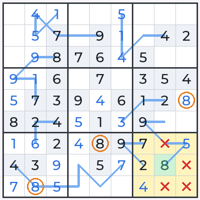

<!-- Written by tools/walkthrough.py region-sum-lines: edit the script, not this page. -->
# Region Sum Lines, step 25: the 8 in box 9

**Step 25 of 49** · [← Step 24](step-24.md) · [All steps](../region-sum-lines.md#the-whole-puzzle-step-by-step) · [Step 26 →](step-26.md)

Box 9 needs an 8. r7c8: row 7 has one (r7c5). r8c9: column 9 has one (r5c9). r9c8 and r9c9: row 9 has one (r9c2). Only **r8c8** is left: **r8c8 = 8**.

**Step 25 of 49** · [← Step 24](step-24.md) · [All steps](../region-sum-lines.md#the-whole-puzzle-step-by-step) · [Step 26 →](step-26.md)
