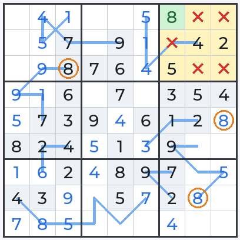

<!-- Written by tools/walkthrough.py region-sum-lines: edit the script, not this page. -->
# Region Sum Lines, step 26: the 8 in box 3

**Step 26 of 49** · [← Step 25](step-25.md) · [All steps](../region-sum-lines.md#the-whole-puzzle-step-by-step) · [Step 27 →](step-27.md)

Box 3 needs an 8. r1c8: column 8 has one (r8c8). r1c9: column 9 has one (r5c9). r3c8 and r3c9: row 3 has one (r3c3). r2c7: its blue line adds up to 10 in another box, and an 8 would make its part in this box 12. Only **r1c7** is left: **r1c7 = 8**.

**Step 26 of 49** · [← Step 25](step-25.md) · [All steps](../region-sum-lines.md#the-whole-puzzle-step-by-step) · [Step 27 →](step-27.md)
