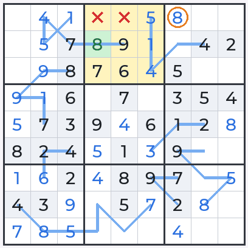

<!-- Written by tools/walkthrough.py region-sum-lines: edit the script, not this page. -->
# Region Sum Lines, step 27: the 8 in box 2

**Step 27 of 49** · [← Step 26](step-26.md) · [All steps](../region-sum-lines.md#the-whole-puzzle-step-by-step) · [Step 28 →](step-28.md)

Box 2 needs an 8. r1c4 and r1c5: row 1 has one (r1c7). Only **r2c4** is left: **r2c4 = 8**.

**Step 27 of 49** · [← Step 26](step-26.md) · [All steps](../region-sum-lines.md#the-whole-puzzle-step-by-step) · [Step 28 →](step-28.md)
