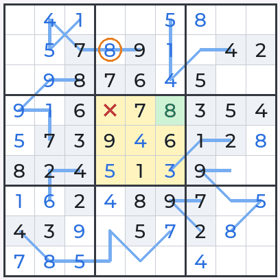

<!-- Written by tools/walkthrough.py region-sum-lines: edit the script, not this page. -->
# Region Sum Lines, step 28: the 8 in box 5

**Step 28 of 49** · [← Step 27](step-27.md) · [All steps](../region-sum-lines.md#the-whole-puzzle-step-by-step) · [Step 29 →](step-29.md)

Box 5 needs an 8. r4c4: column 4 has one (r2c4). Only **r4c6** is left: **r4c6 = 8**.

**Step 28 of 49** · [← Step 27](step-27.md) · [All steps](../region-sum-lines.md#the-whole-puzzle-step-by-step) · [Step 29 →](step-29.md)
