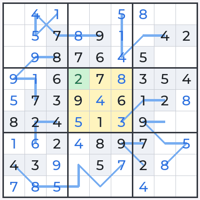

<!-- Written by tools/walkthrough.py region-sum-lines: edit the script, not this page. -->
# Region Sum Lines, step 29: the 2 in box 5

**Step 29 of 49** · [← Step 28](step-28.md) · [All steps](../region-sum-lines.md#the-whole-puzzle-step-by-step) · [Step 30 →](step-30.md)

Box 5 needs a 2, and r4c4 is its last empty cell: **r4c4 = 2**.

**Step 29 of 49** · [← Step 28](step-28.md) · [All steps](../region-sum-lines.md#the-whole-puzzle-step-by-step) · [Step 30 →](step-30.md)
