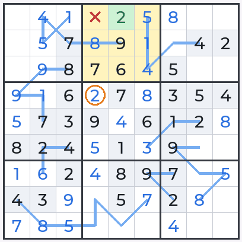

<!-- Written by tools/walkthrough.py region-sum-lines: edit the script, not this page. -->
# Region Sum Lines, step 30: the 2 in box 2

**Step 30 of 49** · [← Step 29](step-29.md) · [All steps](../region-sum-lines.md#the-whole-puzzle-step-by-step) · [Step 31 →](step-31.md)

Box 2 needs a 2. r1c4: column 4 has one (r4c4). Only **r1c5** is left: **r1c5 = 2**.

**Step 30 of 49** · [← Step 29](step-29.md) · [All steps](../region-sum-lines.md#the-whole-puzzle-step-by-step) · [Step 31 →](step-31.md)
