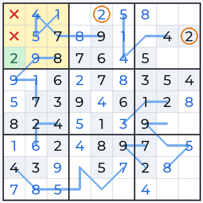

<!-- Written by tools/walkthrough.py region-sum-lines: edit the script, not this page. -->
# Region Sum Lines, step 31: the 2 in box 1

**Step 31 of 49** · [← Step 30](step-30.md) · [All steps](../region-sum-lines.md#the-whole-puzzle-step-by-step) · [Step 32 →](step-32.md)

Box 1 needs a 2. r1c1: row 1 has one (r1c5). r2c1: row 2 has one (r2c9). Only **r3c1** is left: **r3c1 = 2**.

**Step 31 of 49** · [← Step 30](step-30.md) · [All steps](../region-sum-lines.md#the-whole-puzzle-step-by-step) · [Step 32 →](step-32.md)
