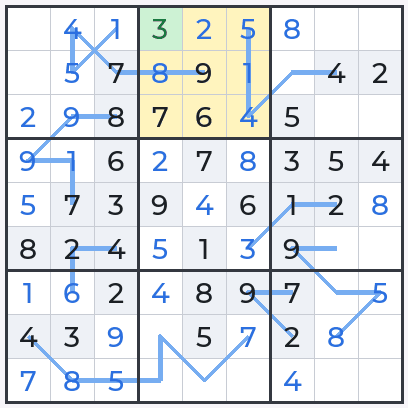

<!-- Written by tools/walkthrough.py region-sum-lines: edit the script, not this page. -->
# Region Sum Lines, step 32: the 3 in box 2

**Step 32 of 49** · [← Step 31](step-31.md) · [All steps](../region-sum-lines.md#the-whole-puzzle-step-by-step) · [Step 33 →](step-33.md)

Box 2 needs a 3, and r1c4 is its last empty cell: **r1c4 = 3**.

**Step 32 of 49** · [← Step 31](step-31.md) · [All steps](../region-sum-lines.md#the-whole-puzzle-step-by-step) · [Step 33 →](step-33.md)
