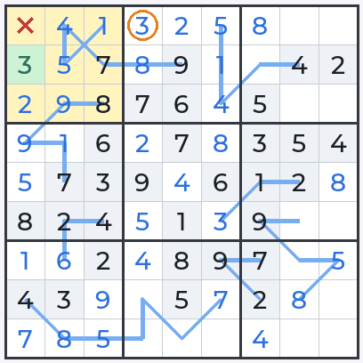

<!-- Written by tools/walkthrough.py region-sum-lines: edit the script, not this page. -->
# Region Sum Lines, step 33: the 3 in box 1

**Step 33 of 49** · [← Step 32](step-32.md) · [All steps](../region-sum-lines.md#the-whole-puzzle-step-by-step) · [Step 34 →](step-34.md)

Box 1 needs a 3. r1c1: row 1 has one (r1c4). Only **r2c1** is left: **r2c1 = 3**.

**Step 33 of 49** · [← Step 32](step-32.md) · [All steps](../region-sum-lines.md#the-whole-puzzle-step-by-step) · [Step 34 →](step-34.md)
