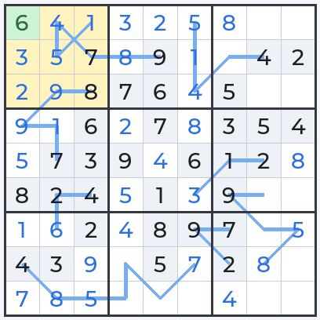

<!-- Written by tools/walkthrough.py region-sum-lines: edit the script, not this page. -->
# Region Sum Lines, step 34: the 6 in box 1

**Step 34 of 49** · [← Step 33](step-33.md) · [All steps](../region-sum-lines.md#the-whole-puzzle-step-by-step) · [Step 35 →](step-35.md)

Box 1 needs a 6, and r1c1 is its last empty cell: **r1c1 = 6**.

**Step 34 of 49** · [← Step 33](step-33.md) · [All steps](../region-sum-lines.md#the-whole-puzzle-step-by-step) · [Step 35 →](step-35.md)
