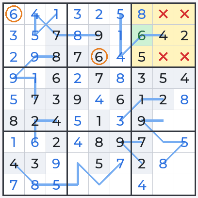

<!-- Written by tools/walkthrough.py region-sum-lines: edit the script, not this page. -->
# Region Sum Lines, step 35: the 6 in box 3

**Step 35 of 49** · [← Step 34](step-34.md) · [All steps](../region-sum-lines.md#the-whole-puzzle-step-by-step) · [Step 36 →](step-36.md)

Box 3 needs a 6. r1c8 and r1c9: row 1 has one (r1c1). r3c8 and r3c9: row 3 has one (r3c5). Only **r2c7** is left: **r2c7 = 6**.

**Step 35 of 49** · [← Step 34](step-34.md) · [All steps](../region-sum-lines.md#the-whole-puzzle-step-by-step) · [Step 36 →](step-36.md)
