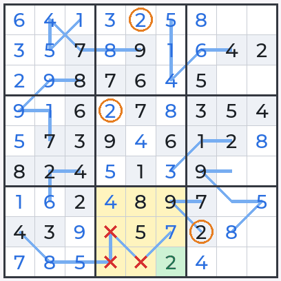

<!-- Written by tools/walkthrough.py region-sum-lines: edit the script, not this page. -->
# Region Sum Lines, step 36: the 2 in box 8

**Step 36 of 49** · [← Step 35](step-35.md) · [All steps](../region-sum-lines.md#the-whole-puzzle-step-by-step) · [Step 37 →](step-37.md)

Box 8 needs a 2. r8c4: row 8 has one (r8c7). r9c4: column 4 has one (r4c4). r9c5: column 5 has one (r1c5). Only **r9c6** is left: **r9c6 = 2**.

**Step 36 of 49** · [← Step 35](step-35.md) · [All steps](../region-sum-lines.md#the-whole-puzzle-step-by-step) · [Step 37 →](step-37.md)
