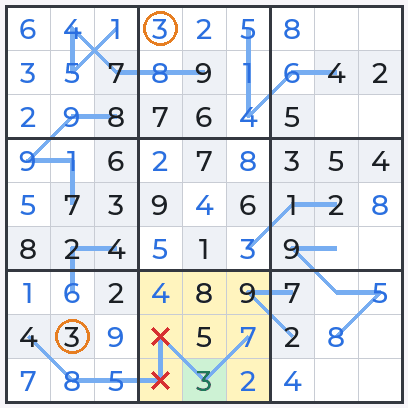

<!-- Written by tools/walkthrough.py region-sum-lines: edit the script, not this page. -->
# Region Sum Lines, step 37: the 3 in box 8

**Step 37 of 49** · [← Step 36](step-36.md) · [All steps](../region-sum-lines.md#the-whole-puzzle-step-by-step) · [Step 38 →](step-38.md)

Box 8 needs a 3. r8c4: row 8 has one (r8c2). r9c4: column 4 has one (r1c4). Only **r9c5** is left: **r9c5 = 3**.

**Step 37 of 49** · [← Step 36](step-36.md) · [All steps](../region-sum-lines.md#the-whole-puzzle-step-by-step) · [Step 38 →](step-38.md)
