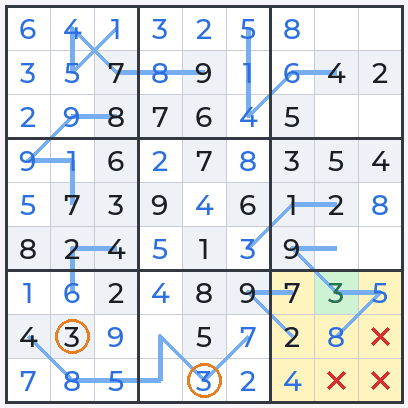

<!-- Written by tools/walkthrough.py region-sum-lines: edit the script, not this page. -->
# Region Sum Lines, step 38: the 3 in box 9

**Step 38 of 49** · [← Step 37](step-37.md) · [All steps](../region-sum-lines.md#the-whole-puzzle-step-by-step) · [Step 39 →](step-39.md)

Box 9 needs a 3. r8c9: row 8 has one (r8c2). r9c8 and r9c9: row 9 has one (r9c5). Only **r7c8** is left: **r7c8 = 3**.

**Step 38 of 49** · [← Step 37](step-37.md) · [All steps](../region-sum-lines.md#the-whole-puzzle-step-by-step) · [Step 39 →](step-39.md)
