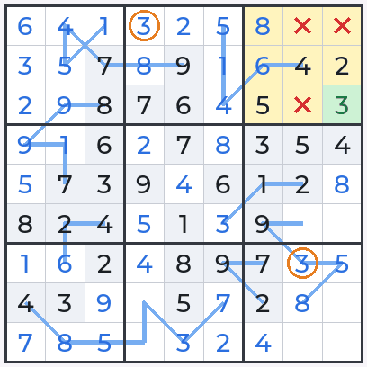

<!-- Written by tools/walkthrough.py region-sum-lines: edit the script, not this page. -->
# Region Sum Lines, step 39: the 3 in box 3

**Step 39 of 49** · [← Step 38](step-38.md) · [All steps](../region-sum-lines.md#the-whole-puzzle-step-by-step) · [Step 40 →](step-40.md)

Box 3 needs a 3. r1c8 and r1c9: row 1 has one (r1c4). r3c8: column 8 has one (r7c8). Only **r3c9** is left: **r3c9 = 3**.

**Step 39 of 49** · [← Step 38](step-38.md) · [All steps](../region-sum-lines.md#the-whole-puzzle-step-by-step) · [Step 40 →](step-40.md)
