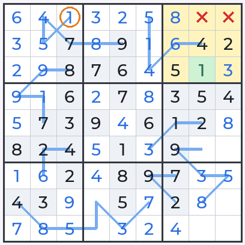

<!-- Written by tools/walkthrough.py region-sum-lines: edit the script, not this page. -->
# Region Sum Lines, step 40: the 1 in box 3

**Step 40 of 49** · [← Step 39](step-39.md) · [All steps](../region-sum-lines.md#the-whole-puzzle-step-by-step) · [Step 41 →](step-41.md)

Box 3 needs a 1. r1c8 and r1c9: row 1 has one (r1c3). Only **r3c8** is left: **r3c8 = 1**.

**Step 40 of 49** · [← Step 39](step-39.md) · [All steps](../region-sum-lines.md#the-whole-puzzle-step-by-step) · [Step 41 →](step-41.md)
