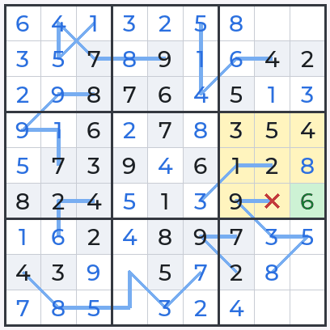

<!-- Written by tools/walkthrough.py region-sum-lines: edit the script, not this page. -->
# Region Sum Lines, step 41: the 6 in box 6

**Step 41 of 49** · [← Step 40](step-40.md) · [All steps](../region-sum-lines.md#the-whole-puzzle-step-by-step) · [Step 42 →](step-42.md)

Box 6 needs a 6. r6c8: its blue line adds up to 16 in another box, and a 6 would make its part in this box 15. Only **r6c9** is left: **r6c9 = 6**.

**Step 41 of 49** · [← Step 40](step-40.md) · [All steps](../region-sum-lines.md#the-whole-puzzle-step-by-step) · [Step 42 →](step-42.md)
