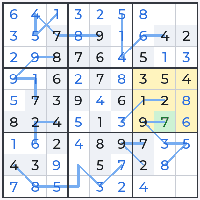

<!-- Written by tools/walkthrough.py region-sum-lines: edit the script, not this page. -->
# Region Sum Lines, step 42: the 7 in box 6

**Step 42 of 49** · [← Step 41](step-41.md) · [All steps](../region-sum-lines.md#the-whole-puzzle-step-by-step) · [Step 43 →](step-43.md)

Box 6 needs a 7, and r6c8 is its last empty cell: **r6c8 = 7**.

**Step 42 of 49** · [← Step 41](step-41.md) · [All steps](../region-sum-lines.md#the-whole-puzzle-step-by-step) · [Step 43 →](step-43.md)
