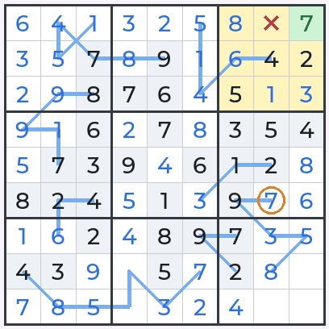

<!-- Written by tools/walkthrough.py region-sum-lines: edit the script, not this page. -->
# Region Sum Lines, step 43: the 7 in box 3

**Step 43 of 49** · [← Step 42](step-42.md) · [All steps](../region-sum-lines.md#the-whole-puzzle-step-by-step) · [Step 44 →](step-44.md)

Box 3 needs a 7. r1c8: column 8 has one (r6c8). Only **r1c9** is left: **r1c9 = 7**.

**Step 43 of 49** · [← Step 42](step-42.md) · [All steps](../region-sum-lines.md#the-whole-puzzle-step-by-step) · [Step 44 →](step-44.md)
