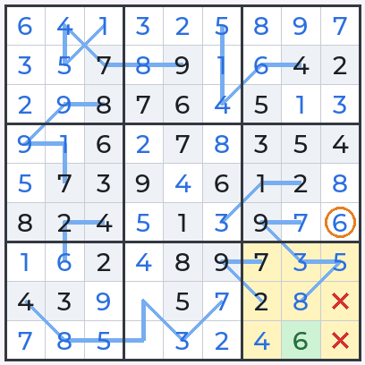

<!-- Written by tools/walkthrough.py region-sum-lines: edit the script, not this page. -->
# Region Sum Lines, step 45: the 6 in box 9

**Step 45 of 49** · [← Step 44](step-44.md) · [All steps](../region-sum-lines.md#the-whole-puzzle-step-by-step) · [Step 46 →](step-46.md)

Box 9 needs a 6. r8c9 and r9c9: column 9 has one (r6c9). Only **r9c8** is left: **r9c8 = 6**.

**Step 45 of 49** · [← Step 44](step-44.md) · [All steps](../region-sum-lines.md#the-whole-puzzle-step-by-step) · [Step 46 →](step-46.md)
