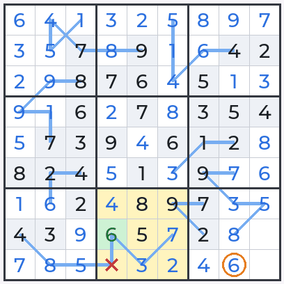

<!-- Written by tools/walkthrough.py region-sum-lines: edit the script, not this page. -->
# Region Sum Lines, step 46: the 6 in box 8

**Step 46 of 49** · [← Step 45](step-45.md) · [All steps](../region-sum-lines.md#the-whole-puzzle-step-by-step) · [Step 47 →](step-47.md)

Box 8 needs a 6. r9c4: row 9 has one (r9c8). Only **r8c4** is left: **r8c4 = 6**.

**Step 46 of 49** · [← Step 45](step-45.md) · [All steps](../region-sum-lines.md#the-whole-puzzle-step-by-step) · [Step 47 →](step-47.md)
