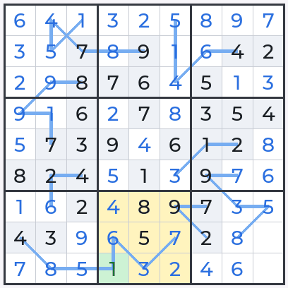

<!-- Written by tools/walkthrough.py region-sum-lines: edit the script, not this page. -->
# Region Sum Lines, step 47: the 1 in box 8

**Step 47 of 49** · [← Step 46](step-46.md) · [All steps](../region-sum-lines.md#the-whole-puzzle-step-by-step) · [Step 48 →](step-48.md)

Box 8 needs a 1, and r9c4 is its last empty cell: **r9c4 = 1**.

**Step 47 of 49** · [← Step 46](step-46.md) · [All steps](../region-sum-lines.md#the-whole-puzzle-step-by-step) · [Step 48 →](step-48.md)
