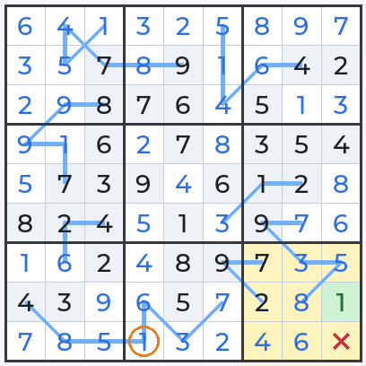

<!-- Written by tools/walkthrough.py region-sum-lines: edit the script, not this page. -->
# Region Sum Lines, step 48: the 1 in box 9

**Step 48 of 49** · [← Step 47](step-47.md) · [All steps](../region-sum-lines.md#the-whole-puzzle-step-by-step) · [Step 49 →](step-49.md)

Box 9 needs a 1. r9c9: row 9 has one (r9c4). Only **r8c9** is left: **r8c9 = 1**.

**Step 48 of 49** · [← Step 47](step-47.md) · [All steps](../region-sum-lines.md#the-whole-puzzle-step-by-step) · [Step 49 →](step-49.md)
