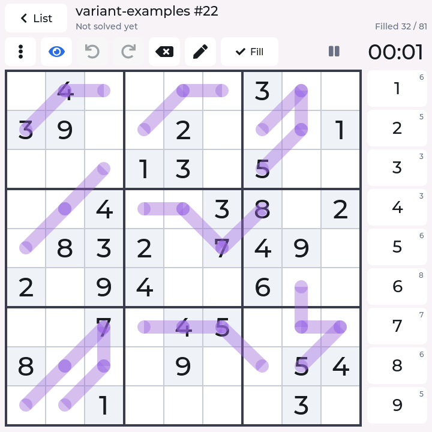
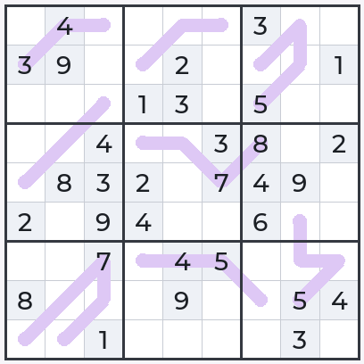

# Renban

[← All variants](README.md) · [Puzzles](../features-puzzles.md) · [How to play](../how-to-play.md)

## The rules

[Classic](classic.md) rules, plus **purple lines** through cells side by side or diagonal. The digits on each line are a **run of consecutive digits, in any order**: a line of four could hold 5, 3, 6, 4 (that's 3 to 6). So no digit repeats on a line, and its smallest and biggest digits are exactly (length − 1) apart.

## On the board

- Each line is a wide translucent purple band under the digits.
- A digit repeated on a line, or digits too far apart for its length, turn red.
- The grader and hints keep, for each cell, the digits that fit some run of the line's length with the line's other cells: "The digits on this line are a run of consecutive digits, so row 6, column 8 can only be 6, 7".
- **Puzzles → ⋮ → New puzzle → Renban**: 8 lines (Hard and Expert 10) of 3 to 5 cells.

## How to solve it

- **A known digit bounds the run:** on a line of four with a 5, the run is somewhere from 2–5 to 5–8, so every other cell on it is 2 to 8.
- **Two known digits bound it more:** with a 6 and a 7 on a line of five, the run is 3–7, 4–8 or 5–9.
- **No repeats on a line,** even across boxes: that's a hidden rule people miss.
- **The middle of a long run is certain:** a line of seven always holds 3 to 7, whatever its ends.

## Worked example

**variant-examples #22**, Renban Easy (see [Classic](classic.md#worked-example-the-whole-puzzle) for how to import the examples; cells are written r*row*c*column*). The lines are in the screenshot; two matter here:

- a line of **four**: r8c8 (a 5), r7c9, r7c8 and r6c8;
- a line of **five**: r9c1, r8c2, r7c3 (a 7), r8c3 and r9c2.

**Step 1: r6c8, on the line of four with a 5.** Row 6 has 2, 4, 6 and 9; column 8 has 3 and 5; box 6 has an 8. By the Classic rules r6c8 could be 1 or 7. Its line holds four consecutive digits including the 5, so it runs somewhere from 2–5 to 5–8: never down to 1. **r6c8 = 7**.

**Step 2: r8c3, on the line of five with a 7.** Row 8 has 4, 5, 8 and 9; column 3 has 1, 3 and 7; that leaves 2 and 6. Its line holds five consecutive digits including the 7: from 3–7 to 5–9, never down to 2. **r8c3 = 6**.

**Step 3: r8c2, on the same line.** Row 8 now has 4, 5, 6, 8 and 9; box 7 has 1 and 7; that leaves 2 and 3. The line has 7 and 6 now: its run is 3–7, 4–8 or 5–9, so 2 is still out. **r8c2 = 3**, and the line's run is 3–7: r9c1 and r9c2 will hold 4 and 5.

## The whole puzzle, step by step

<!-- walkthrough -->
<!-- Written by tools/walkthrough.py renban: edit the script, not this part. -->

The whole puzzle, from the start to the last cell: 49 steps, each one a single (one place left for a digit, or one digit left for a cell), taken in the order a box's single comes first, so not quite the order of the worked example above. Each step has a page of its own, with **Previous** and **Next**: pick its number below. In each picture, the unit the step looks at is tinted yellow (for a cell with one digit left: its row, column and box), the new digit is on green, the digits that rule cells out have an **orange ring**, and the empty cells they rule out a **red cross**. Givens are on grey, digits from earlier steps in blue.

| [1](renban/step-01.md) | [2](renban/step-02.md) | [3](renban/step-03.md) | [4](renban/step-04.md) | [5](renban/step-05.md) | [6](renban/step-06.md) | [7](renban/step-07.md) | [8](renban/step-08.md) | [9](renban/step-09.md) | [10](renban/step-10.md) |
|:-:|:-:|:-:|:-:|:-:|:-:|:-:|:-:|:-:|:-:|
| [11](renban/step-11.md) | [12](renban/step-12.md) | [13](renban/step-13.md) | [14](renban/step-14.md) | [15](renban/step-15.md) | [16](renban/step-16.md) | [17](renban/step-17.md) | [18](renban/step-18.md) | [19](renban/step-19.md) | [20](renban/step-20.md) |
| [21](renban/step-21.md) | [22](renban/step-22.md) | [23](renban/step-23.md) | [24](renban/step-24.md) | [25](renban/step-25.md) | [26](renban/step-26.md) | [27](renban/step-27.md) | [28](renban/step-28.md) | [29](renban/step-29.md) | [30](renban/step-30.md) |
| [31](renban/step-31.md) | [32](renban/step-32.md) | [33](renban/step-33.md) | [34](renban/step-34.md) | [35](renban/step-35.md) | [36](renban/step-36.md) | [37](renban/step-37.md) | [38](renban/step-38.md) | [39](renban/step-39.md) | [40](renban/step-40.md) |
| [41](renban/step-41.md) | [42](renban/step-42.md) | [43](renban/step-43.md) | [44](renban/step-44.md) | [45](renban/step-45.md) | [46](renban/step-46.md) | [47](renban/step-47.md) | [48](renban/step-48.md) | [49](renban/step-49.md) |  |

Solved.

<!-- /walkthrough -->
