# Renban

[← All variants](README.md) · [Puzzles](../features-puzzles.md) · [How to play](../how-to-play.md)

## The rules

[Classic](classic.md) rules, plus **purple lines** through cells side by side or diagonal. The digits on each line are a **run of consecutive digits, in any order**: a line of four could hold 5, 3, 6, 4 (that's 3 to 6). So no digit repeats on a line, and its smallest and biggest digits are exactly (length − 1) apart.

## On the board

- Each line is a wide translucent purple band under the digits.
- A digit repeated on a line, or digits too far apart for its length, turn red.
- The grader and hints keep, for each cell, the digits that fit some run of the line's length with the line's other cells: "The digits on this line are a run of consecutive digits, so row 6, column 8 can only be 6, 7".
- **Puzzles → ⋮ → New puzzle → Renban**: 8 lines (Hard and Expert 10) of 3 to 5 cells.

## How to solve it

- **A known digit bounds the run:** on a line of four with a 5, the run is somewhere from 2–5 to 5–8, so every other cell on it is 2 to 8.
- **Two known digits bound it more:** with a 6 and a 7 on a line of five, the run is 3–7, 4–8 or 5–9.
- **No repeats on a line,** even across boxes: that's a hidden rule people miss.
- **The middle of a long run is certain:** a line of seven always holds 3 to 7, whatever its ends.

## Worked example

**variant-examples #22**, Renban Easy (see [Classic](classic.md#worked-example-the-whole-puzzle) for how to import the examples; cells are written r*row*c*column*). The lines are in the screenshot; two matter here:

- a line of **four**: r8c8 (a 5), r7c9, r7c8 and r6c8;
- a line of **five**: r9c1, r8c2, r7c3 (a 7), r8c3 and r9c2.

**Step 1: r6c8, on the line of four with a 5.** Row 6 has 2, 4, 6 and 9; column 8 has 3 and 5; box 6 has an 8. By the Classic rules r6c8 could be 1 or 7. Its line holds four consecutive digits including the 5, so it runs somewhere from 2–5 to 5–8: never down to 1. **r6c8 = 7**.

**Step 2: r8c3, on the line of five with a 7.** Row 8 has 4, 5, 8 and 9; column 3 has 1, 3 and 7; that leaves 2 and 6. Its line holds five consecutive digits including the 7: from 3–7 to 5–9, never down to 2. **r8c3 = 6**.

**Step 3: r8c2, on the same line.** Row 8 now has 4, 5, 6, 8 and 9; box 7 has 1 and 7; that leaves 2 and 3. The line has 7 and 6 now: its run is 3–7, 4–8 or 5–9, so 2 is still out. **r8c2 = 3**, and the line's run is 3–7: r9c1 and r9c2 will hold 4 and 5.

## The whole puzzle, step by step

<!-- walkthrough -->
<!-- Written by tools/walkthrough.py renban: edit the script, not this part. -->

The whole puzzle, from the start to the last cell: 49 steps, each one a single (one place left for a digit, or one digit left for a cell), taken in the order a box's single comes first, so not quite the order of the worked example above. In each picture, the unit the step looks at is tinted yellow (for a cell with one digit left: its row, column and box), the new digit is on green, the digits that rule cells out have an **orange ring**, and the empty cells they rule out a **red cross**. Givens are on grey, digits from earlier steps in blue.

#### Step 1: the 1 in box 1

Box 1 needs a 1. r1c3: column 3 has one (r9c3). r2c3: row 2 has one (r2c9). r3c1, r3c2 and r3c3: row 3 has one (r3c4). Only **r1c1** is left: **r1c1 = 1**.

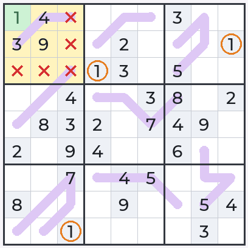

#### Step 2: the 9 in box 5

Box 5 needs a 9. r4c5: column 5 has one (r8c5). r5c5: row 5 has one (r5c8). r6c5 and r6c6: row 6 has one (r6c3). Only **r4c4** is left: **r4c4 = 9**.

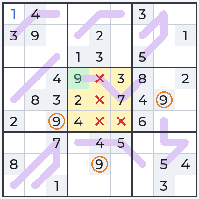

#### Step 3: the 1 in box 6

Box 6 needs a 1. r5c9 and r6c9: column 9 has one (r2c9). r6c8: its purple line of 4 cells already has 5: with a 1 the digits couldn't be a run of 4. Only **r4c8** is left: **r4c8 = 1**.

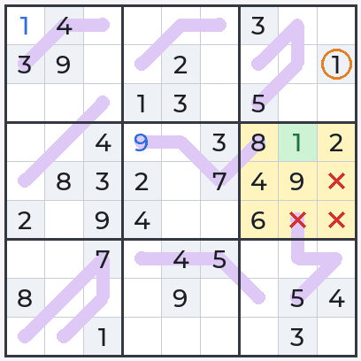

#### Step 4: the 1 in box 4

Box 4 needs a 1. r4c1 and r4c2: row 4 has one (r4c8). r5c1: column 1 has one (r1c1). Only **r6c2** is left: **r6c2 = 1**.

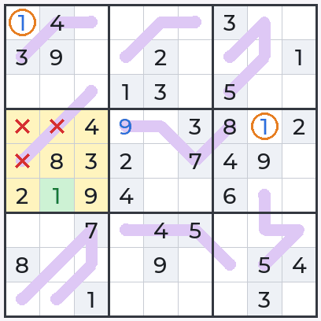

#### Step 5: the 1 in box 5

Box 5 needs a 1. r4c5: row 4 has one (r4c8). r6c5 and r6c6: row 6 has one (r6c2). Only **r5c5** is left: **r5c5 = 1**.

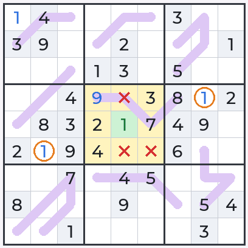

#### Step 6: the 5 in box 5

Box 5 needs a 5. r6c6: column 6 has one (r7c6). r4c5: its purple line of 4 cells already has 7, 8 and 9: with a 5 the digits couldn't be a run of 4. Only **r6c5** is left: **r6c5 = 5**.

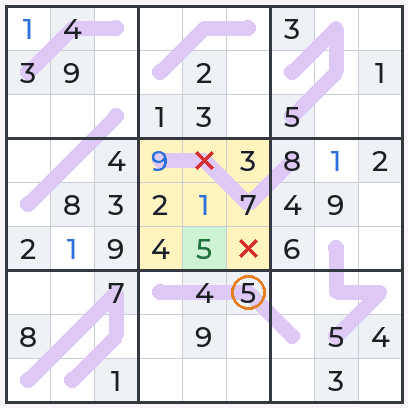

#### Step 7: the 6 in box 5

Box 5 needs a 6. r6c6: row 6 has one (r6c7). Only **r4c5** is left: **r4c5 = 6**.

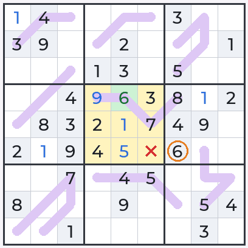

#### Step 8: the 6 in box 4

Box 4 needs a 6. r4c1 and r4c2: row 4 has one (r4c5). Only **r5c1** is left: **r5c1 = 6**.

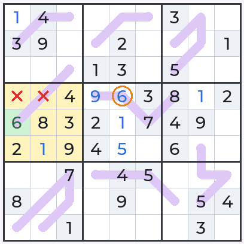

#### Step 9: the 8 in box 5

Box 5 needs an 8, and r6c6 is its last empty cell: **r6c6 = 8**.

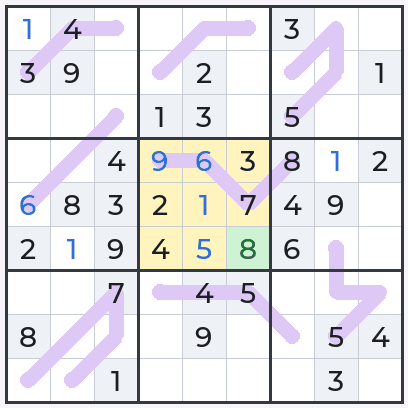

#### Step 10: the 3 in box 6

Box 6 needs a 3. r5c9: row 5 has one (r5c3). r6c8: column 8 has one (r9c8). Only **r6c9** is left: **r6c9 = 3**.

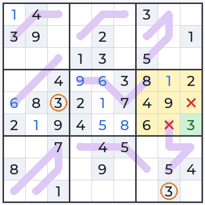

#### Step 11: the 5 in box 6

Box 6 needs a 5. r6c8: row 6 has one (r6c5). Only **r5c9** is left: **r5c9 = 5**.

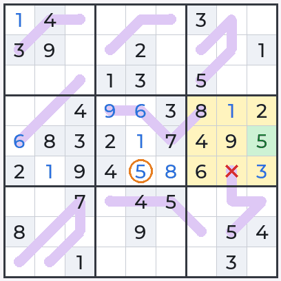

#### Step 12: the 7 in box 6

Box 6 needs a 7, and r6c8 is its last empty cell: **r6c8 = 7**.

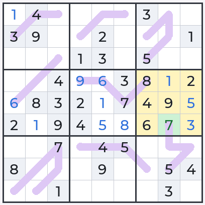

#### Step 13: the 2 in box 7

Box 7 needs a 2. r7c1 and r9c1: column 1 has one (r6c1). r8c2, r8c3 and r9c2: its purple line of 5 cells already has 7: with a 2 the digits couldn't be a run of 5. Only **r7c2** is left: **r7c2 = 2**.

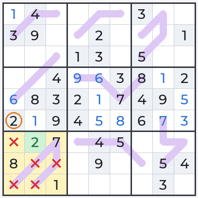

#### Step 14: the 2 in box 1

Box 1 needs a 2. r2c3: row 2 has one (r2c5). r3c1: column 1 has one (r6c1). r3c2: column 2 has one (r7c2). r3c3: its purple line of 3 cells already has 6: with a 2 the digits couldn't be a run of 3. Only **r1c3** is left: **r1c3 = 2**.

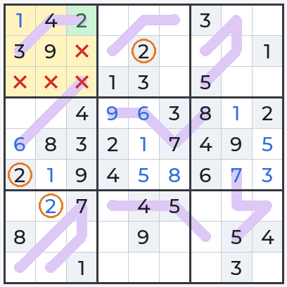

#### Step 15: the 5 in box 1

Box 1 needs a 5. r3c1, r3c2 and r3c3: row 3 has one (r3c7). Only **r2c3** is left: **r2c3 = 5**.

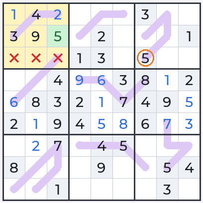

#### Step 16: the 6 in box 1

Box 1 needs a 6. r3c1: column 1 has one (r5c1). r3c3: its purple line already has a 6. Only **r3c2** is left: **r3c2 = 6**.

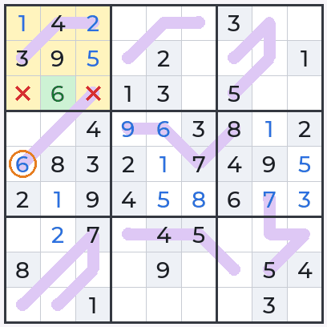

#### Step 17: the 7 in box 1

Box 1 needs a 7. r3c3: column 3 has one (r7c3). Only **r3c1** is left: **r3c1 = 7**.

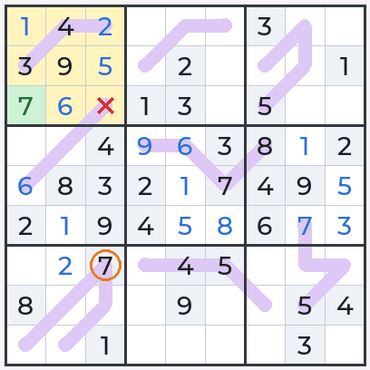

#### Step 18: the 8 in box 1

Box 1 needs an 8, and r3c3 is its last empty cell: **r3c3 = 8**.

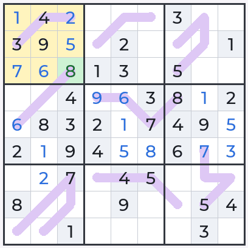

#### Step 19: the 5 in box 2

Box 2 needs a 5. r1c5: column 5 has one (r6c5). r1c6: column 6 has one (r7c6). r2c4 and r2c6: row 2 has one (r2c3). r3c6: row 3 has one (r3c7). Only **r1c4** is left: **r1c4 = 5**.

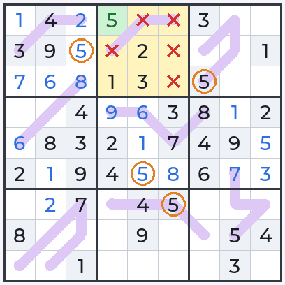

#### Step 20: the 2 in box 3

Box 3 needs a 2. r1c8 and r1c9: row 1 has one (r1c3). r2c7 and r2c8: row 2 has one (r2c5). r3c9: column 9 has one (r4c9). Only **r3c8** is left: **r3c8 = 2**.

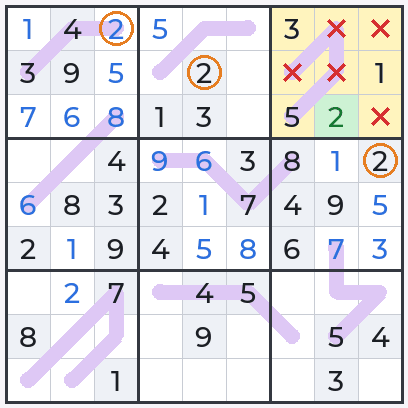

#### Step 21: the 4 in box 3

Box 3 needs a 4. r1c8 and r1c9: row 1 has one (r1c2). r2c7: column 7 has one (r5c7). r3c9: column 9 has one (r8c9). Only **r2c8** is left: **r2c8 = 4**.

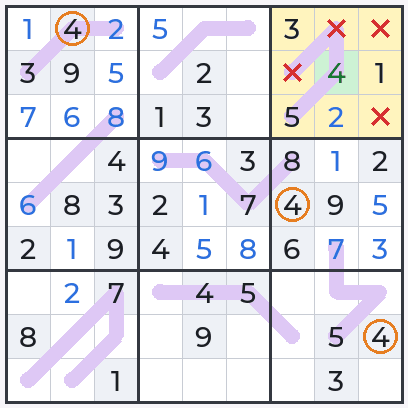

#### Step 22: the 4 in box 2

Box 2 needs a 4. r1c5 and r1c6: row 1 has one (r1c2). r2c4 and r2c6: row 2 has one (r2c8). Only **r3c6** is left: **r3c6 = 4**.

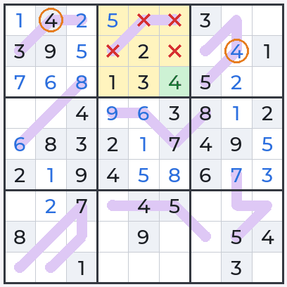

#### Step 23: the 9 in box 2

Box 2 needs a 9. r1c5: column 5 has one (r8c5). r2c4 and r2c6: row 2 has one (r2c2). Only **r1c6** is left: **r1c6 = 9**.

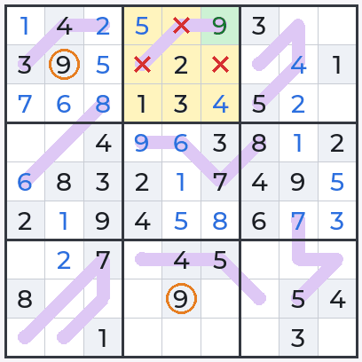

#### Step 24: the 6 in box 2

Box 2 needs a 6. r1c5: column 5 has one (r4c5). r2c4: its purple line of 3 cells already has 9: with a 6 the digits couldn't be a run of 3. Only **r2c6** is left: **r2c6 = 6**.

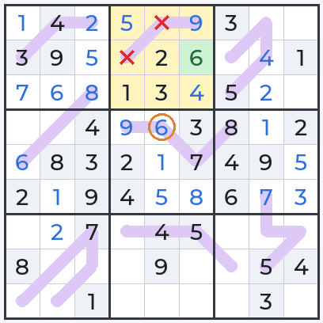

#### Step 25: the 8 in box 3

Box 3 needs an 8. r2c7: column 7 has one (r4c7). r3c9: row 3 has one (r3c3). r1c8: its purple line of 4 cells already has 4 and 5: with an 8 the digits couldn't be a run of 4. Only **r1c9** is left: **r1c9 = 8**.

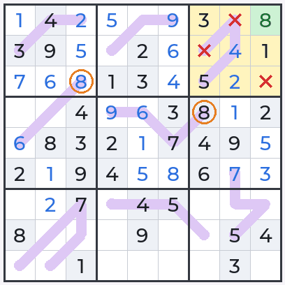

#### Step 26: the 8 in box 2

Box 2 needs an 8. r1c5: row 1 has one (r1c9). Only **r2c4** is left: **r2c4 = 8**.

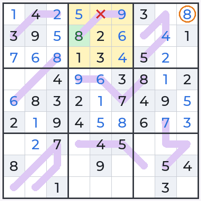

#### Step 27: the 7 in box 2

Box 2 needs a 7, and r1c5 is its last empty cell: **r1c5 = 7**.

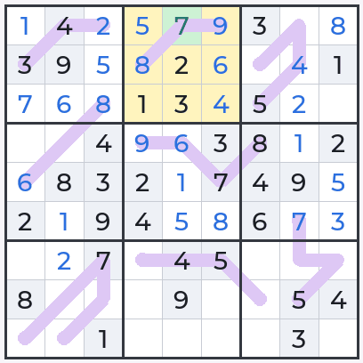

#### Step 28: the 6 in box 3

Box 3 needs a 6. r2c7: row 2 has one (r2c6). r3c9: row 3 has one (r3c2). Only **r1c8** is left: **r1c8 = 6**.

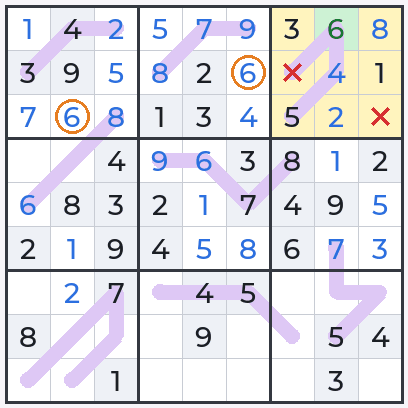

#### Step 29: the 7 in box 3

Box 3 needs a 7. r3c9: row 3 has one (r3c1). Only **r2c7** is left: **r2c7 = 7**.

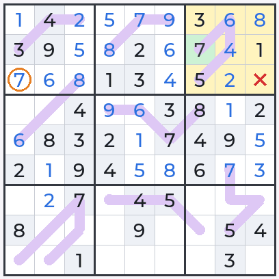

#### Step 30: the 9 in box 3

Box 3 needs a 9, and r3c9 is its last empty cell: **r3c9 = 9**.

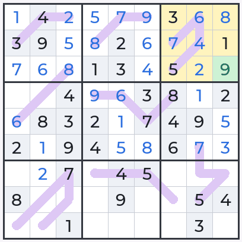

#### Step 31: the 5 in box 4

Box 4 needs a 5. r4c2: its purple line of 3 cells already has 6 and 8: with a 5 the digits couldn't be a run of 3. Only **r4c1** is left: **r4c1 = 5**.

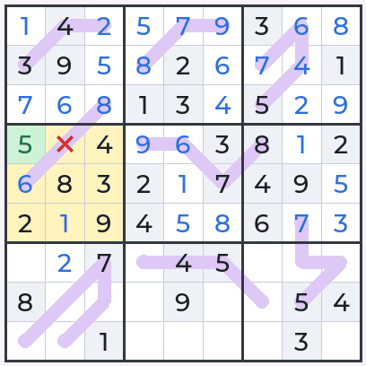

#### Step 32: the 7 in box 4

Box 4 needs a 7, and r4c2 is its last empty cell: **r4c2 = 7**.

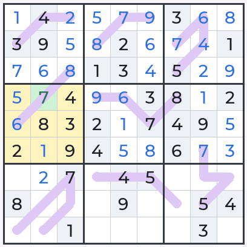

#### Step 33: the 3 in box 7

Box 7 needs a 3. r7c1: column 1 has one (r2c1). r8c3: column 3 has one (r5c3). r9c1 and r9c2: row 9 has one (r9c8). Only **r8c2** is left: **r8c2 = 3**.

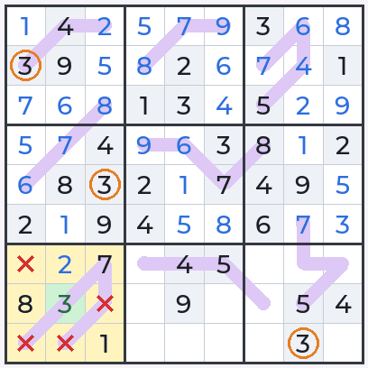

#### Step 34: the 4 in box 7

Box 7 needs a 4. r7c1: row 7 has one (r7c5). r8c3: row 8 has one (r8c9). r9c2: column 2 has one (r1c2). Only **r9c1** is left: **r9c1 = 4**.

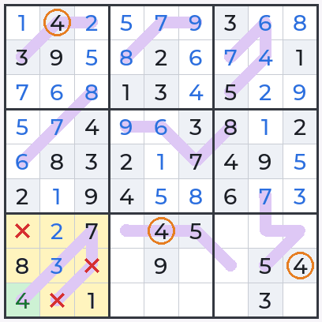

#### Step 35: the 5 in box 7

Box 7 needs a 5. r7c1: row 7 has one (r7c6). r8c3: row 8 has one (r8c8). Only **r9c2** is left: **r9c2 = 5**.

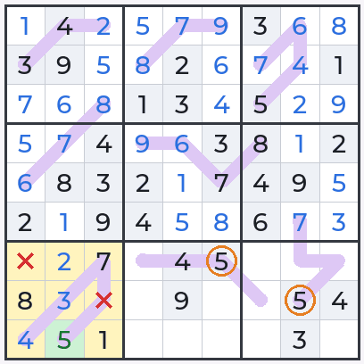

#### Step 36: the 6 in box 7

Box 7 needs a 6. r7c1: column 1 has one (r5c1). Only **r8c3** is left: **r8c3 = 6**.

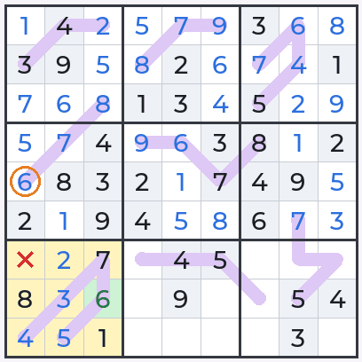

#### Step 37: the 9 in box 7

Box 7 needs a 9, and r7c1 is its last empty cell: **r7c1 = 9**.

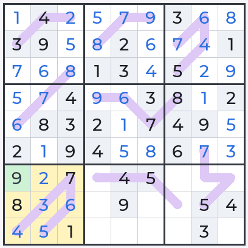

#### Step 38: the 1 in box 8

Box 8 needs a 1. r7c4 and r8c4: column 4 has one (r3c4). r9c4, r9c5 and r9c6: row 9 has one (r9c3). Only **r8c6** is left: **r8c6 = 1**.

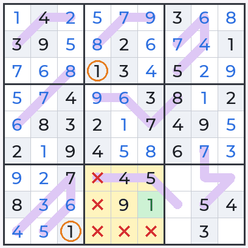

#### Step 39: the 2 in box 8

Box 8 needs a 2. r7c4: row 7 has one (r7c2). r8c4 and r9c4: column 4 has one (r5c4). r9c5: column 5 has one (r2c5). Only **r9c6** is left: **r9c6 = 2**.

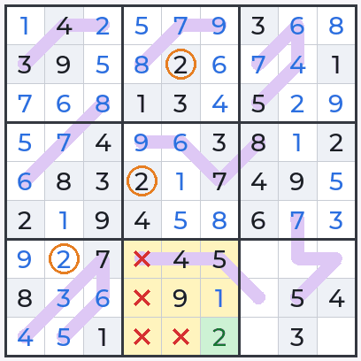

#### Step 40: the 3 in box 8

Box 8 needs a 3. r8c4: row 8 has one (r8c2). r9c4 and r9c5: row 9 has one (r9c8). Only **r7c4** is left: **r7c4 = 3**.

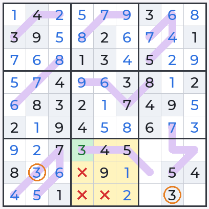

#### Step 41: the 6 in box 8

Box 8 needs a 6. r8c4: row 8 has one (r8c3). r9c5: column 5 has one (r4c5). Only **r9c4** is left: **r9c4 = 6**.

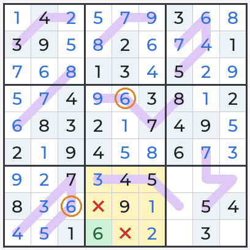

#### Step 42: the 7 in box 8

Box 8 needs a 7. r9c5: column 5 has one (r1c5). Only **r8c4** is left: **r8c4 = 7**.

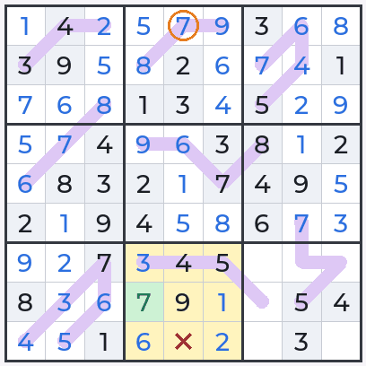

#### Step 43: the 8 in box 8

Box 8 needs an 8, and r9c5 is its last empty cell: **r9c5 = 8**.

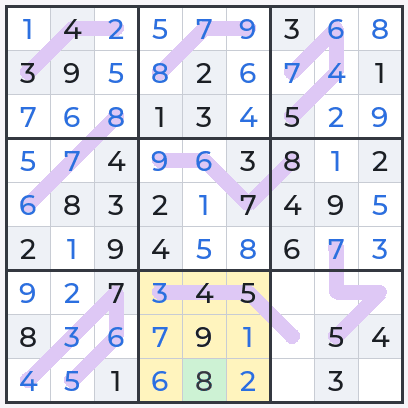

#### Step 44: the 1 in box 9

Box 9 needs a 1. r7c8: column 8 has one (r4c8). r7c9: column 9 has one (r2c9). r8c7: row 8 has one (r8c6). r9c7 and r9c9: row 9 has one (r9c3). Only **r7c7** is left: **r7c7 = 1**.

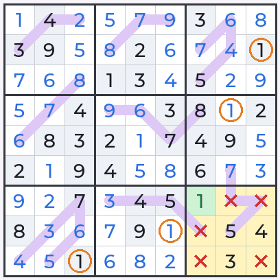

#### Step 45: the 2 in box 9

Box 9 needs a 2. r7c8 and r7c9: row 7 has one (r7c2). r9c7 and r9c9: row 9 has one (r9c6). Only **r8c7** is left: **r8c7 = 2**.

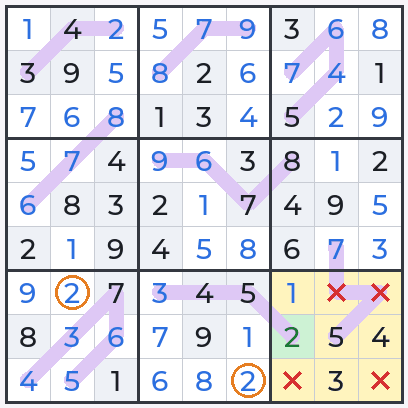

#### Step 46: the 6 in box 9

Box 9 needs a 6. r7c8: column 8 has one (r1c8). r9c7 and r9c9: row 9 has one (r9c4). Only **r7c9** is left: **r7c9 = 6**.

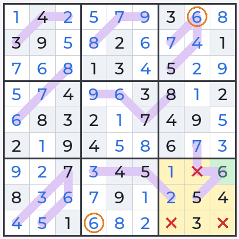

#### Step 47: the 7 in box 9

Box 9 needs a 7. r7c8: row 7 has one (r7c3). r9c7: column 7 has one (r2c7). Only **r9c9** is left: **r9c9 = 7**.

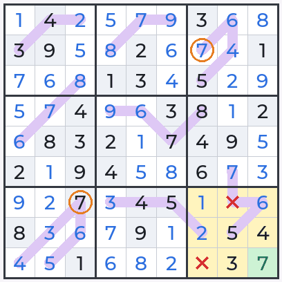

#### Step 48: the 8 in box 9

Box 9 needs an 8. r9c7: row 9 has one (r9c5). Only **r7c8** is left: **r7c8 = 8**.

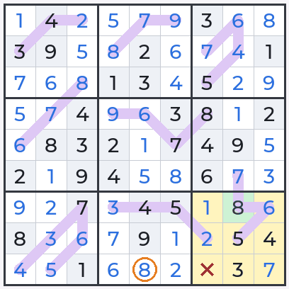

#### Step 49: the 9 in box 9

Box 9 needs a 9, and r9c7 is its last empty cell: **r9c7 = 9**.

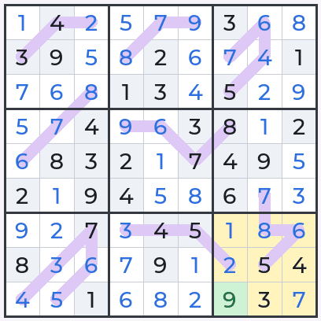

Solved.

<!-- /walkthrough -->
