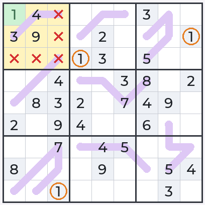

<!-- Written by tools/walkthrough.py renban: edit the script, not this page. -->
# Renban, step 1: the 1 in box 1

**Step 1 of 49** · [← The start](../renban.md#the-whole-puzzle-step-by-step) · [All steps](../renban.md#the-whole-puzzle-step-by-step) · [Step 2 →](step-02.md)

Box 1 needs a 1. r1c3: column 3 has one (r9c3). r2c3: row 2 has one (r2c9). r3c1, r3c2 and r3c3: row 3 has one (r3c4). Only **r1c1** is left: **r1c1 = 1**.

**Step 1 of 49** · [← The start](../renban.md#the-whole-puzzle-step-by-step) · [All steps](../renban.md#the-whole-puzzle-step-by-step) · [Step 2 →](step-02.md)
